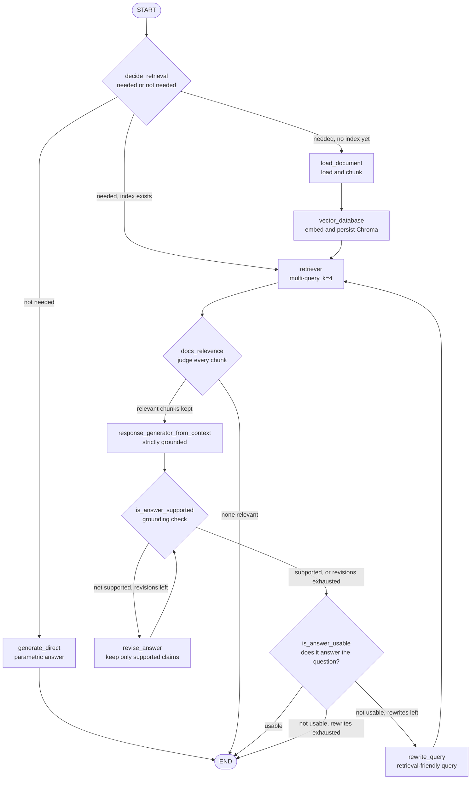

<div align="center">

# 🧠 Self-Reflective RAG

### A LangGraph implementation of Self-RAG. An agent that decides when to retrieve, then critiques its own answer.

*It decides whether to retrieve. It filters what it finds. It checks its answer for hallucination, then for usefulness, and fixes itself until it passes or runs out of tries.*

[](https://www.python.org/)
[](https://openreview.net/forum?id=hSyW5go0v8)
[](https://arxiv.org/abs/2310.11511)
[](https://www.langchain.com/langgraph)
[](https://www.langchain.com/)
[](https://groq.com/)
[](https://www.trychroma.com/)
[](https://huggingface.co/)
[](https://streamlit.io/)
[](https://hub.docker.com/r/codebyzaigham/self-reflective-rag)
[](LICENSE)

<br>


</div>

---

## Overview

Standard RAG always retrieves, always generates, and never looks back. It retrieves even when the question doesn't need documents, it feeds the LLM whatever the retriever returns, and it never checks whether the answer is actually supported by that context.

**Self-RAG**, introduced in [*Self-RAG: Learning to Retrieve, Generate, and Critique through Self-Reflection* (Asai et al., ICLR 2024)](https://openreview.net/forum?id=hSyW5go0v8), changes that. The model decides **when** to retrieve, judges **each retrieved passage**, and critiques **its own output** using special *reflection tokens*.

This repository re-implements that idea as a **cyclic LangGraph state machine**. The paper's reflection tokens become separate, explicit **critic nodes**, so every self-check is visible, testable, and routable. A Streamlit interface streams the graph live and shows which checks ran and what each one decided.

| Reflection step | Question the agent asks itself | If the answer is "no" |
|---|---|---|
| 🧭 **Decide retrieval** | Does this query need the knowledge base at all? | Answer directly from the model's own knowledge |
| 🧪 **Relevance** | Does this retrieved chunk actually help answer the query? | Drop the chunk. If none survive, stop with "no answer found in docs" |
| 🛡️ **Support (grounding)** | Is every claim in the answer backed by the retrieved context? | **Revise** the answer using only the context, then re-check |
| ✅ **Usefulness** | Does the answer actually satisfy the question? | **Rewrite the query**, retrieve again, and regenerate |

Two nested loops, one for hallucination repair and one for retrieval retry, are both capped, so the graph always terminates.

> **Scope note.** This is a *prompting-based* adaptation of Self-RAG's architecture. It does **not** train a critic or generator with reflection tokens, and it does not implement the paper's segment-level beam search. The [Fidelity to the Paper](#fidelity-to-the-paper) section spells out exactly what is faithful, adapted, or out of scope.

---

## Table of Contents

- [Highlights](#highlights)
- [Self-RAG at a Glance](#self-rag-at-a-glance)
- [Architecture](#architecture)
- [Fidelity to the Paper](#fidelity-to-the-paper)
- [How I Studied the Paper](#how-i-studied-the-paper)
- [The Self-Correction Loop in Action](#the-self-correction-loop-in-action)
- [Interactive UI](#interactive-ui)
- [LangGraph Concepts Demonstrated](#langgraph-concepts-demonstrated)
- [Design Decisions](#design-decisions)
- [Tech Stack](#tech-stack)
- [Project Structure](#project-structure)
- [Getting Started](#getting-started)
- [Configuration](#configuration)
- [Known Limitations](#known-limitations)
- [Roadmap](#roadmap)
- [Reference](#reference)
- [License](#license)

---

## Highlights

- **Adaptive retrieval.** An LLM classifier decides per query whether to retrieve at all. General questions skip the vector store entirely.
- **Four independent critics.** Retrieval-need, chunk relevance, answer support, and answer usefulness are each a dedicated node with a strict single-word output contract.
- **Orthogonal judges by design.** The grounding critic judges *only* factual support. The usefulness critic judges *only* whether the question was answered, and explicitly does not check facts. Neither can excuse a failure of the other.
- **Two nested, capped feedback loops.** An inner *revise* loop (hallucination repair) and an outer *rewrite-and-retrieve* loop (retrieval retry), each limited to two attempts.
- **Strictly grounded generation.** The generator may use only retrieved context, must return an exact refusal string when context is insufficient, and treats retrieved text as data, ignoring instructions inside it.
- **Multi-query retrieval** over a persistent Chroma index, so one question is searched several ways before critics ever see the chunks.
- **Live, inspectable UI.** Streams graph execution with `stream_mode="updates"`, highlighting the active node and logging each critic's verdict.
- **Multi-format ingestion** (PDF, TXT, CSV, PPT/PPTX) with per-format chunking profiles.
- **Dockerized.** A ready-to-run image is published on Docker Hub.

---

## Self-RAG at a Glance

The figure below is from the paper. On the left is conventional RAG, which retrieves a fixed set of passages and generates from all of them. On the right is Self-RAG, which retrieves on demand, judges each passage (*Relevant / Irrelevant*), judges its own output (*Supported / Partially*), and selects the best.


<sub>*Figure from Asai et al., "Self-RAG: Learning to Retrieve, Generate, and Critique through Self-Reflection", ICLR 2024.*</sub>

---

## Architecture



**Reading the graph**

1. **`decide_retrieval`** is the entry point. It classifies the query as `needed` or `not needed`, and the router branches accordingly. For `needed`, it checks whether a Chroma index already exists, reusing it or building one from the uploaded document.
2. **`docs_relevence`** judges *each* retrieved chunk against the query and keeps only the relevant ones.
3. **`response_generator_from_context`** answers using only the surviving chunks.
4. **Inner loop (hallucination repair).** `is_answer_supported` checks that every claim is grounded. On failure, `revise_answer` rewrites the answer to keep only supported claims, then the check runs again.
5. **Outer loop (retrieval retry).** `is_answer_usable` checks the answer against the question. On failure, `rewrite_query` produces a better search query and the pipeline retrieves again from the top.

### The routers

```python
# edges.py: conditional routing drives both feedback loops
graph.add_conditional_edges("decide_retrieval", retrieval_needed)     # → retriever | load_document | generate_direct
graph.add_conditional_edges("docs_relevence",   is_relevent)          # → generate | END
graph.add_conditional_edges("is_answer_supported", is_factual)        # → revise_answer | is_answer_usable
graph.add_conditional_edges("is_answer_usable", is_answer_complete)   # → rewrite_query | END

graph.add_edge("revise_answer", "is_answer_supported")                # inner loop
graph.add_edge("rewrite_query", "retriever")                          # outer loop
```

### Shared state

```python
class state(TypedDict):
    doc_path: str;  query: str;  chunks: List[Document]
    database: Chroma;  retrieved_docs: List[Document];  response: str

    retrieval_needed:    Literal["needed", "not needed"]
    relevent_docs:       List[Document]
    is_answer_supported: Literal["supported", "not supported"]
    is_answer_usable:    Literal["usable", "not usable"]

    revise_attempts:   int      # bounds the inner loop
    retrieve_attempts: int      # bounds the outer loop
```

---

## Fidelity to the Paper

An honest mapping from the paper to this code.

| Paper component | In the paper | In this repo | Status |
|---|---|---|---|
| **Reflection tokens** | Special tokens (`Retrieve`, `ISREL`, `ISSUP`, `ISUSE`) generated by a **trained** LM | Each token's role is played by a **prompted LLM critic node** with a strict output format. No training | 🔶 Adapted |
| **Retrieve on demand** | Model predicts whether to retrieve, including `continue` during generation | `decide_retrieval` makes a binary `needed` / `not needed` call once per query | 🔶 Adapted |
| **ISREL** (passage relevance) | `Relevant` / `Irrelevant` per retrieved passage | `docs_relevence` returns `relevent` / `not_relevent` per chunk and drops the rest | ✅ Faithful concept |
| **ISSUP** (support) | `Fully` / `Partially` / `No support` | Binary `supported` / `not supported`, deliberately strict: one unsupported claim fails it | 🔶 Adapted |
| **ISUSE** (utility) | Graded 1 to 5 | Binary `usable` / `not usable` | 🔶 Adapted |
| **Segment-level generation** | Generate per passage in parallel, one segment at a time | Single generation from all relevant chunks together | ⏳ Not implemented |
| **Critique-guided beam search** | Rank candidates by weighted reflection scores | Not implemented | ⏳ Not implemented |
| **Training** | Critic and generator trained on reflection-token data | None. Zero-shot prompting on `gpt-oss-120b` (Groq) | ⏳ Out of scope |
| **Benchmark evaluation** | Open-domain QA, reasoning and long-form tasks | Not reproduced | ⏳ Out of scope |

**Beyond the paper:** the explicit *revise* loop and the *query-rewrite* loop are agentic additions in the spirit of corrective and adaptive RAG, not part of Self-RAG itself. The paper's critique steers *selection* among candidate generations, whereas here the critiques trigger *repair* of a single answer.

---

## How I Studied the Paper

Before coding, I annotated the graph by hand to pin down what each node checks and where each loop must stop. The two green annotations flag the loops that *must* be bounded, which became the `revise_attempts` and `retrieve_attempts` counters in the state.


<sub>*The compiled graph as rendered by LangGraph. The annotated version is at the top of this README.*</sub>

---

## The Self-Correction Loop in Action

Both screenshots are real terminal runs on a hard question over a deep-learning textbook: *"explain me K-mean clustering Algorithm using example given in the book."* The log lines are the node names firing in order.

### 🔁 Watching the loops fire
The critics don't pass the first draft. The log shows the **revise → re-check** inner loop and the **rewrite query → retrieve again** outer loop repeating as the agent tries to reach a grounded, useful answer.


### ✅ Settling on a grounded answer
After a revision and a query rewrite, the retrieved chunks pass the relevance filter, the answer passes the grounding and usefulness checks, and the pipeline returns a final answer taken from the book's own description of the algorithm.


---

## Interactive UI

A Streamlit app (`UI/app.py`) turns the graph into something you can watch.


**What it gives you**

- **Knowledge-base panel.** Upload a PDF, TXT, CSV, PPT or PPTX, or point to a path. The sidebar shows whether a vector index exists and lets you clear it.
- **Live pipeline diagram.** Built from the graph's own structure, with the active node highlighted orange and completed nodes green, updated on every step of `workflow.stream(..., stream_mode="updates")`.
- **Step-by-step log.** One line per node with its outcome, such as *retrieved N chunks*, *kept N relevant chunks*, `supported`, or the *rewritten query*.
- **Verdict badges** on every answer: *Retrieval*, *Grounded* and *Usable*.
- **Per-message pipeline trace** you can expand later, plus graceful error display if a run stops early.
- **Reset conversation** and **Clear vector database** controls.

---

## LangGraph Concepts Demonstrated

| Concept | Where to find it |
|---|---|
| `StateGraph` over a typed `TypedDict` | `Graph/state.py`, `Graph/edges.py` |
| **Cyclic graphs** with two nested loops | `revise_answer → is_answer_supported`, `rewrite_query → retriever` |
| **Four conditional routers** | `Graph/edges.py` → `retrieval_needed`, `is_relevent`, `is_factual`, `is_answer_complete` |
| **Loop counters in state** to guarantee termination | `revise_attempts`, `retrieve_attempts` |
| **LLM-as-critic nodes** with strict output contracts | `Graph/nodes.py` → `decide_retrieval`, `docs_relevence`, `is_answer_supported`, `is_answer_usable` |
| **Streaming execution** (`values` in the CLI, `updates` in the UI) | `Graph/graph.py`, `UI/app.py` |
| Multi-query retrieval over a persistent store | `Graph/RAG_pipelines/retriever.py`, `embeddings.py` |
| Containerized deployment | `Dockerfile` |

---

## Design Decisions

| Decision | Reasoning |
|---|---|
| **Critics as separate nodes, not one mega-prompt** | Each check is individually visible, routable, and replaceable, which is the point of a graph. |
| **Grounding and usefulness judged separately** | An answer can be faithful but unhelpful, or helpful but invented. Separate critics catch each failure without masking the other. |
| **Single-word critic outputs** | A strict `supported` / `not supported` style contract makes routing a simple string comparison. |
| **Strict-by-default grounding critic** | One unsupported claim fails the check. For a RAG system, a false "supported" is worse than an unnecessary revision. |
| **Revision uses only the context** | The revise prompt forbids adding new facts, so repair can only *remove or soften* claims, never invent replacements. |
| **Retrieval retry rewrites the query** | If the answer was unusable, the likeliest culprit is the query's wording. Rewriting it targets the cause instead of regenerating blindly. |
| **Cap both loops** | Cycles are what make agents powerful and what make them dangerous. Counters in state guarantee termination and bound cost. |
| **Skip retrieval when it isn't needed** | Saves latency and avoids polluting a general answer with irrelevant chunks. |
| **Exact refusal string in the generator** | A fixed "not enough information" reply makes grounding behavior checkable. |
| **Treat retrieved text as data** | The generator prompt tells the model to ignore instructions embedded in documents (a prompt-level injection mitigation). |
| **Persist the index, build once** | Embedding is expensive and query-independent, so the graph reuses the on-disk Chroma store. |

---

## Tech Stack

| Layer | Technology |
|---|---|
| Orchestration | **LangGraph**: `StateGraph`, conditional edges, streaming |
| LLM framework | **LangChain**: prompt templates, `RunnableSequence`, output parsers |
| LLM | **Groq** `openai/gpt-oss-120b` for every critic, the rewriter and both generators |
| Embeddings | `sentence-transformers/all-MiniLM-L6-v2` via `langchain-huggingface` (local) |
| Vector store | **ChromaDB** via `langchain-chroma` (persisted to `chromadb/`) |
| Retrieval | `MultiQueryRetriever` over top-4 similarity search |
| Document loading | `PyPDFLoader`, `TextLoader`, `CSVLoader`, `UnstructuredPowerPointLoader` |
| Splitting | `RecursiveCharacterTextSplitter` (per-format profiles) |
| UI | **Streamlit** with live Graphviz rendering |
| Packaging | **Docker** (`python:3.13-slim`, CPU-only PyTorch) |
| Config | `python-dotenv` |

---

## Project Structure

```
SelfReflective-RAG/
├── Graph/
│   ├── state.py                 # typed shared state: verdicts + loop counters
│   ├── nodes.py                 # decide, relevance, generate, support, revise, usability, rewrite
│   ├── edges.py                 # graph wiring + the four routers → compiled `workflow`
│   ├── LLM.py                   # Groq LLM factory
│   ├── graph.py                 # CLI runner: set doc_path + query, stream the workflow
│   └── RAG_pipelines/
│       ├── document_loader.py   # PDF / TXT / CSV / PPT(X) loaders
│       ├── text_splitter.py     # per-format chunking profiles
│       ├── embeddings.py        # MiniLM embeddings + persistent Chroma
│       └── retriever.py         # multi-query retriever
│
├── UI/
│   └── app.py                   # Streamlit app with live graph trace
│
├── screenshots/                 # paper figure, annotated graph, UI, terminal runs
├── Pdfs/                        # your documents (not included)
├── chromadb/                    # generated vector index (git-ignored)
├── Dockerfile
├── .dockerignore
├── requirements.txt
├── LICENSE
└── README.md
```

---

## Getting Started

### Prerequisites

- Python 3.11+ (or just Docker)
- A [Groq](https://console.groq.com/) API key

### 1 · Install

```bash
git clone https://github.com/CodeByZaigham/SelfReflective-RAG.git
cd SelfReflective-RAG

python -m venv .venv
source .venv/bin/activate          # Windows: .venv\Scripts\activate

pip install -r requirements.txt
```

### 2 · Add your key

Create a `.env` file in the **project root**:

```env
GROQ_API_KEY=your_groq_key
# HF_TOKEN=optional                # silences the HuggingFace rate-limit warning
```

### 3 · Run it

Run from the **project root**, because the Chroma index path (`chromadb/`) is resolved relative to the working directory. The first run downloads the MiniLM embedding model (about 90 MB).

**Option A: Streamlit UI (recommended)**

```bash
streamlit run UI/app.py
```

Upload a document in the sidebar and ask a question. The first query that needs retrieval builds the index automatically. Use **Clear vector database** when you switch documents, because an existing index is reused.

**Option B: Command line**

Put a document in `Pdfs/`, set `doc_path` and `query` in `Graph/graph.py`, then:

```bash
python Graph/graph.py
```

The terminal prints each stage as it runs (deciding retrieval, checking relevance, revising, rewriting) and then the final answer.

### Run with Docker

```bash
docker pull codebyzaigham/self-reflective-rag

docker run --rm -p 8501:8501 \
  -e GROQ_API_KEY=your_groq_key \
  codebyzaigham/self-reflective-rag
```

Open `http://localhost:8501` and upload a document in the UI. To keep the vector index between container runs, add `-v "$(pwd)/chromadb:/app/chromadb"`.

---

## Configuration

| Setting | Where | Value |
|---|---|---|
| LLM | `Graph/LLM.py` | Groq `openai/gpt-oss-120b`, `max_retries=4` |
| Max revisions (inner loop) | `Graph/edges.py` → `is_factual` | `2` |
| Max query rewrites (outer loop) | `Graph/edges.py` → `is_answer_complete` | `2` |
| Retrieved chunks per query | `Graph/RAG_pipelines/retriever.py` | `k = 4` (before multi-query expansion) |
| Chunking: PDF / TXT | `Graph/RAG_pipelines/text_splitter.py` | 1200 size, 150 overlap |
| Chunking: PowerPoint | same | 500 size, 100 overlap |
| Chunking: CSV | same | 300 size, 50 overlap |
| Embedding model | `Graph/RAG_pipelines/embeddings.py` | `all-MiniLM-L6-v2` |
| Vector store location | `Graph/RAG_pipelines/embeddings.py` | `chromadb/` |

---

## Known Limitations

Listed openly, because knowing where an implementation departs from its source is part of understanding it.

- **Reflection is prompted, not trained.** The critics are zero-shot LLM judges, so their verdicts are only as reliable as the prompts and the model. There is no critic model trained on reflection-token data.
- **Verdicts are binary.** The paper's graded `ISSUP` (fully / partially / no) and `ISUSE` (1 to 5) are collapsed into pass / fail.
- **No segment-level generation or beam search.** The answer is generated once from all relevant chunks, then repaired, not selected among parallel candidates.
- **Latency scales with retrieved chunks.** Relevance is judged one chunk per LLM call, sequentially, and each loop iteration adds several more calls.
- **The rewritten query replaces the original.** After a rewrite, later nodes see the rewritten query, which can drift from the user's wording.
- **An existing index is reused for any document.** Switching documents requires clearing the vector database.
- **Critic outputs are matched as strings.** A model reply that deviates from the exact format falls to a default branch. Schema-validated output would be sturdier.
- **No benchmark reproduction and no automated tests yet.**

---

## Roadmap

- [ ] **Graded critics:** replace binary verdicts with 3-level support and 1 to 5 usefulness scores, as in the paper
- [ ] **Segment-level generation:** produce one candidate per retrieved passage in parallel (LangGraph `Send` API) and select by critique score
- [ ] **Parallel relevance judging** with `.batch()` to cut latency
- [ ] **Preserve the original query** alongside the rewritten one
- [ ] **Structured critic outputs** with `with_structured_output` instead of string matching
- [ ] **Per-document collections** so multiple knowledge bases coexist
- [ ] **Evaluation harness** comparing groundedness against a plain RAG baseline on a small QA set
- [ ] **LangSmith tracing**: the `@traceable` hooks are already stubbed in the RAG pipeline modules
- [ ] **Unit tests** for the routers and loop caps with a mocked LLM

---

## Reference

This project implements the architecture from:

> Asai, Wu, Wang, Sil, Hajishirzi. **Self-RAG: Learning to Retrieve, Generate, and Critique through Self-Reflection.** ICLR 2024. [OpenReview](https://openreview.net/forum?id=hSyW5go0v8) · [arXiv:2310.11511](https://arxiv.org/abs/2310.11511)

All credit for the Self-RAG method belongs to the paper's authors. This repository is an independent, prompting-based implementation built for learning and demonstration.

---

## License

Released under the [MIT License](LICENSE).

---

<div align="center">

**Built by [CodeByZaigham](https://github.com/CodeByZaigham)**

*If this helped you understand Self-RAG, a ⭐ is much appreciated.*

</div>